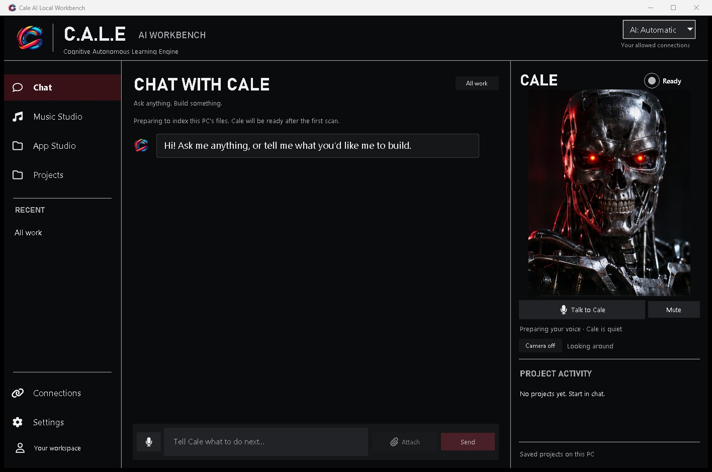

# Cale AI Workbench

### Your AI. All in one Workbench.

Build apps. Make music. Browse the web. Turn your ideas into something you can use.

**[Download for Windows](https://github.com/CaleMediaDev/cale-ai-workbench-downloads/releases/latest/download/Cale-AI-Workbench-light-Setup.exe)** &nbsp; · &nbsp; **[Explore the demos](https://calemedia.com/cale-ai-workbench-white-paper/#proven-results)**

Free seven-day trial · Windows x64 · No GitHub account needed

## Meet C.A.L.E.

**Cognitive Autonomous Learning Engine.** Your AI assistant for turning ideas into things you can use. Cale brings your connected AI and local models into one workspace to help you build apps, make music and work with your files.

**More power for bigger jobs.** Connect ChatGPT, Grok or another supported AI account for harder tasks or a faster response. Use it alongside AI running on your PC, in the same workspace.

**Start with free AI.** Connect a free AI account and start creating with Cale.

## Small AI. Useful work.

A model’s answer is only the beginning. Cale gives it a workspace to build, preview and check what it makes.

### Same model. Different result.

| Model on its own | Same model + Cale |
| :---: | :---: |
|  |  |
| Did not pass the required game checks. | Built a playable prototype in **67.51 seconds**. Passed **13 logic checks and 5 browser checks**. |
| [Open the model’s output](https://calemedia.com/wp-content/uploads/2026/11/workbench-model-demo-20261108/model-alone.html) | **[Play the Cale result](https://calemedia.com/wp-content/uploads/2026/11/workbench-model-demo-20261108/with-cale.html)** |

Recorded game demo using the same underlying model in two workflows. [See the results and test conditions](https://calemedia.com/cale-ai-workbench-white-paper/#sources).

## Browse the web with Cale

Web Browser AI puts Cale beside the page you’re using. Ask it to find information, read pages or fill in forms. Watch it work in the built-in browser, take control when you need to, and hand the task back to Cale.

## Build your app. See it come to life.

Describe what you want to make in App Studio. Build and preview your app, refine it in chat, and export an Android APK. You can also export an Apple project to build on a Mac with Xcode.

## Create music. Mix tracks. Make it yours.

Turn an idea into a song, work with stems and MIDI, or bring your own music to the two-deck mixer. Create and mix in the same workspace.

**[Press play. Hear what Cale made.](https://calemedia.com/cale-ai-workbench-white-paper/#cw-song-demo)**  
Cale Club · Original AI-generated song · 3 minutes

## Create visuals on your PC

Generate images, make short video clips and turn reference images into 3D meshes. This blue ceramic cup was generated locally with Workbench.

## Get started

1. **[Download the Windows installer](https://github.com/CaleMediaDev/cale-ai-workbench-downloads/releases/latest/download/Cale-AI-Workbench-light-Setup.exe).** Setup downloads and verifies the resources for you.
2. **Start your free seven-day trial.** Internet access is required for setup and trial activation.
3. **Tell Cale what you want to make.** Connect an AI account or use the bundled local tools.

After the trial, [contact Cale Media](https://calemedia.com/contact/) for an access code. Bundled local tools can work offline while access is valid.

### Before you install

| | Current complete setup |
| :--- | :--- |
| Platform | Windows x64 |
| Resource downloads | Approximately 64 GB |
| Installed files | Approximately 84 GB |
| Free space on one drive | Approximately 148 GB when the download cache and installation share a drive |

Actual requirements depend on selected resources and existing cached files. The small installer downloads additional resources during setup.

**Already using Workbench?** Run the latest installer to receive the updated help guides. Workbench checks for compatible app updates while open and online; some releases still require the installer. Back up important projects before updating.

---

**[Download Workbench](https://github.com/CaleMediaDev/cale-ai-workbench-downloads/releases/latest/download/Cale-AI-Workbench-light-Setup.exe)** · [Product demos](https://calemedia.com/cale-ai-workbench-white-paper/) · [Setup and access-code help](https://calemedia.com/contact/)

© Cale Media. Proprietary software. Required third-party licenses and source notices accompany the software.
