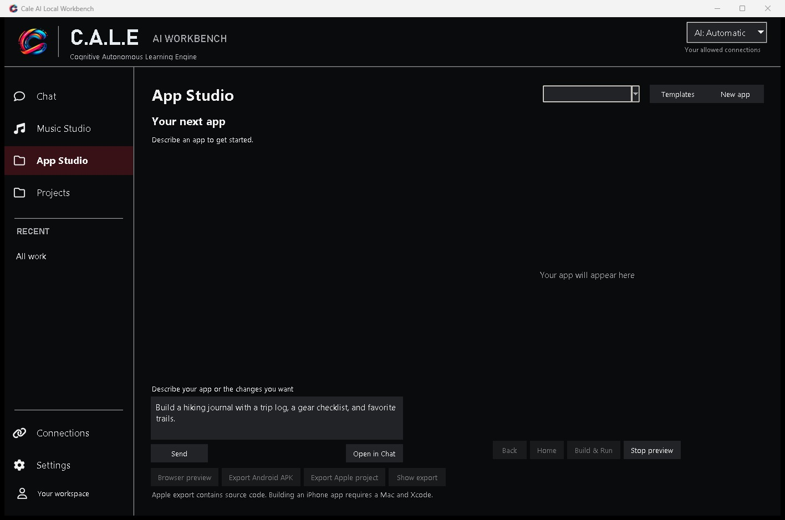

# Cale AI Workbench

## [Download for Windows](https://github.com/CaleMediaDev/cale-ai-workbench-downloads/releases/latest/download/Cale-AI-Workbench-light-Setup.exe)

**Free 7-day trial · No GitHub account needed**

Go from a blank prompt to a playable prototype, a track you can mix, or an image you can use. Workbench gives you a desktop space to make things with AI and keep your project files together.

### Meet your Workbench

Start in Chat with Cale. Ask a question, attach a document, or describe a website or game you want to build. Jump between Chat, App Studio, Music Studio, and Projects from the same window.

### Turn an idea into a mobile app

Tell App Studio what you want to make or start from a bundled template. Refine your app in chat, preview it in the browser or on an Android emulator, and export an Android APK. You can also export an Apple project to build on a Mac with Xcode.

### Make a song. Mix it in the same app.

Generate a track from an idea, separate stems, turn audio into MIDI, or bring your own music to the two-deck mixer. The Music Studio gives you hands-on controls for cueing, looping, and mixing.

### Create visuals on your PC

Generate images, make short video clips, and turn reference images into 3D meshes. This blue ceramic cup was generated locally with Workbench.

### Get started

Run the Windows x64 installer. Setup downloads and verifies the offline package for you. Connect to the internet for setup and to start your **free seven-day trial**. After seven days, enter an access code from Cale Media. Bundled local tools can work offline while access is valid.

Allow about **64 GB** for the download cache and **84 GB** for installation. If both use the same drive, plan for about **148 GB** free.

[Explore Workbench on Cale Media](https://calemedia.com/cale-ai-workbench-white-paper/) · [Get setup or access-code help](https://calemedia.com/contact/)
