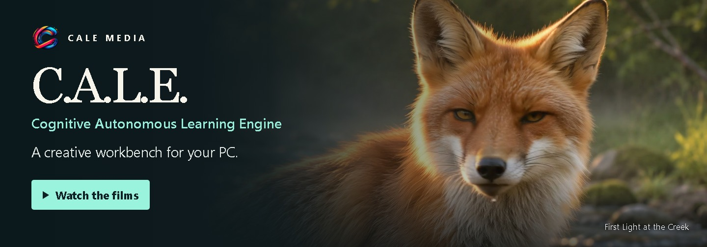
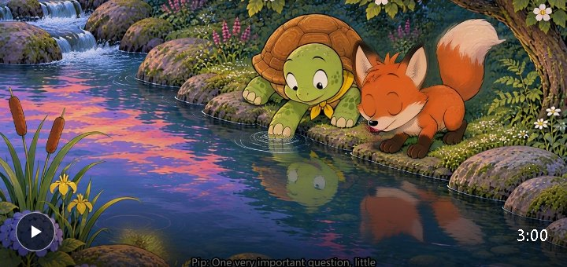
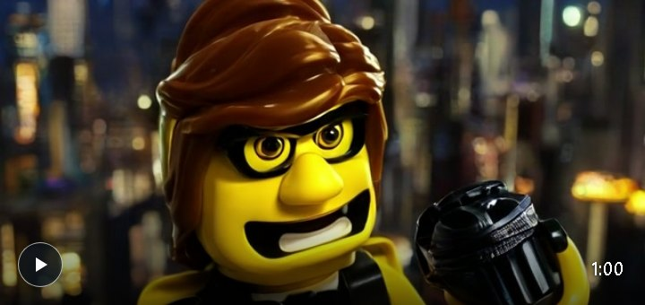
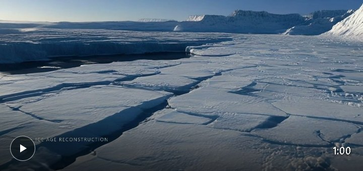
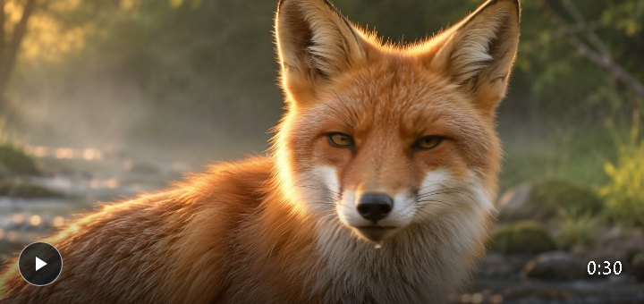

**[Download for Windows x64](https://github.com/CaleMediaDev/cale-ai-workbench-downloads/releases/latest/download/Cale-AI-Workbench-light-Setup.exe)**　·　[Watch the Workbench tour · 3:17](https://calemediadev.github.io/cale-ai-workbench-downloads/#inside-cale)　·　[Release notes and checksums](https://github.com/CaleMediaDev/cale-ai-workbench-downloads/releases/latest)

**C.A.L.E.** stands for **Cognitive Autonomous Learning Engine**. Cale Media built this free Windows workbench to create on your own PC. Turn a script into a narrated film, make an original song or radio station, or turn a photo into a model you can print. Download the studio models during setup to create offline on your own hardware.

## Made with Workbench

| | |
| --- | --- |
|  |  |
| **[The Backwards Blink](https://calemediadev.github.io/cale-ai-workbench-downloads/#backwards-blink)** · 3:00 Pip the fox and Moss the turtle follow a blinking light through the woods in a full cartoon episode. | **[Brick Beat](https://calemediadev.github.io/cale-ai-workbench-downloads/#brick-beat)** · 1:00 A minifigure takes the mic in a city built from bricks. A vertical music video with an original rap. |
|  |  |
| **[Where the Ice Went](https://calemediadev.github.io/cale-ai-workbench-downloads/#where-the-ice-went)** · 1:00 A narrated Great Lakes documentary told through shoreline scenes, maps and cross sections. English captions available. | **[First Light at the Creek](https://calemediadev.github.io/cale-ai-workbench-downloads/#first-light)** · 0:30 A generated wildlife short. Watch a red fox and other creek life in the first light of day. |

## Inside the studio

- **Video Studio** turns prompts and screenplays into clips with sound. Give a returning character a new scene by typing their saved subject name.
- **Music Studio** records original songs with vocals, runs a local radio station in your chosen genre and puts four decks on the DJ mixer.
- **Images and 3D Studio** generate artwork and turn prompts or reference images into models. Preview your filament colors and export a 3MF or STL for printing.

## Install on Windows

Run the [Windows x64 installer](https://github.com/CaleMediaDev/cale-ai-workbench-downloads/releases/latest/download/Cale-AI-Workbench-light-Setup.exe) and open **Cale AI Workbench**. Existing Rust installations may appear in Windows as **Cale Workbench Preview**. They receive signed updates in place. The app is free, and donations are optional.

[Support development on Venmo](https://venmo.com/u/tahoecale) · [Cale Media](https://calemedia.com/cale-ai-workbench-white-paper/) · [Contact](https://calemedia.com/contact/)

© Cale Media. Third-party license notices are included with the software.
