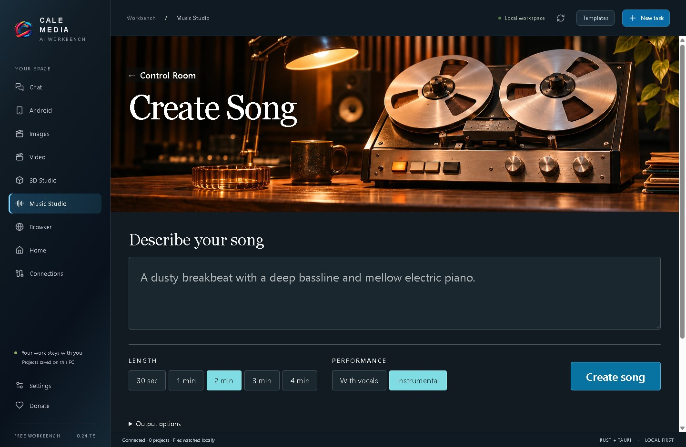
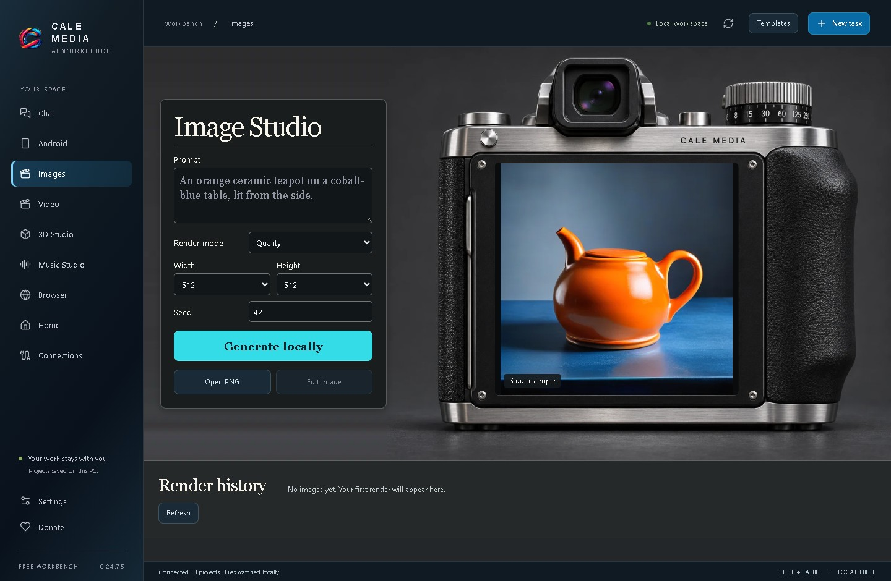
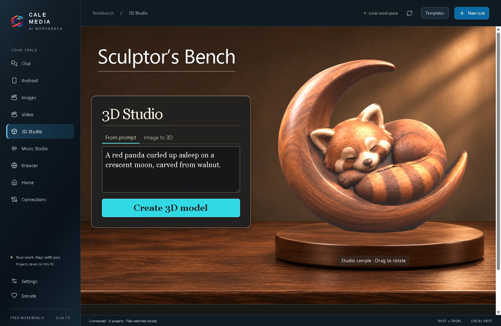
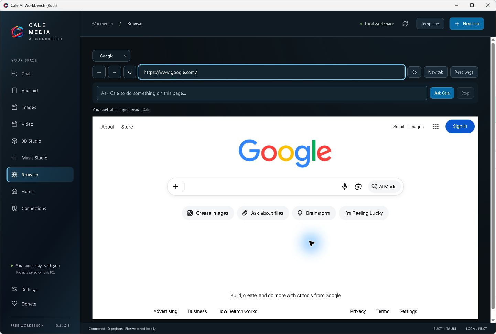
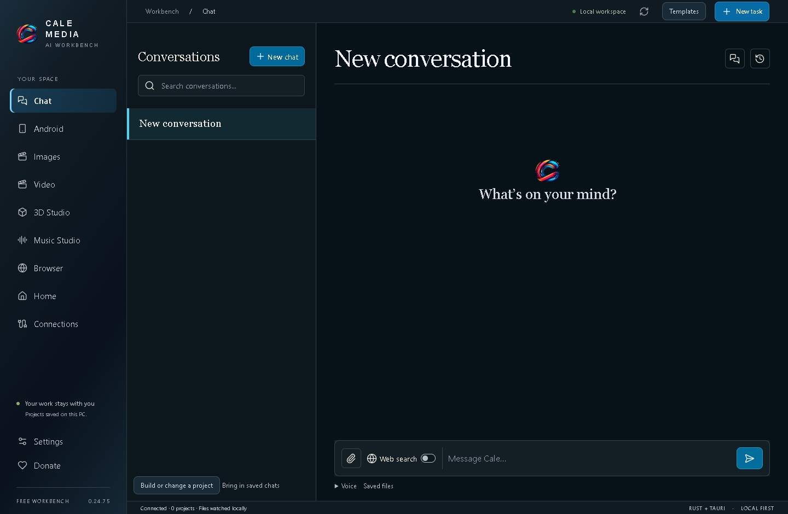

# C.A.L.E.

**Cognitive Autonomous Learning Engine** by Cale Media. A free Windows workbench for making music, videos, images and 3D models on your own PC.

**[Download for Windows x64](https://github.com/CaleMediaDev/cale-ai-workbench-downloads/releases/latest/download/Cale-AI-Workbench-light-Setup.exe)** · [Release notes and checksums](https://github.com/CaleMediaDev/cale-ai-workbench-downloads/releases/latest)

## Last Light at the Rink

Sage Hart opens on the first sung line in this one-minute rock performance made with C.A.L.E. Press play and use the speaker control to hear the song.

https://github.com/user-attachments/assets/adcb5622-1e79-40b4-ba0b-2d1599f1bdc2

[Open the dedicated player](https://calemediadev.github.io/cale-ai-workbench-downloads/)

## One prompt, one finished music video

Once the studios are set up, describe the song, the scene and the length in a single prompt.

> Make a one-minute rock music video. A singer performs at a roller rink with a live band. Start on the first sung line and hold one camera angle.

Press **Generate**. Video Studio makes the soundtrack, renders the sections, joins them and exports a single MP4. There’s no timeline to assemble or clips to stitch by hand.

### Performance on the home PC

| Featured master | Measured result |
| --- | --- |
| Hardware | NVIDIA GeForce RTX 3060 with 12 GB of VRAM · AMD Ryzen 9 5900X |
| Picture | 864 × 1536 portrait · 24 fps · 1,440 frames |
| Duration | 60 seconds with vocals and band |
| Full-minute master render | 2 hr 25 min 45 sec on this PC |

The player streams a smaller web copy. Render time varies with the scene, settings and hardware.

## Inside Workbench

| Music Studio | Image Studio |
| --- | --- |
|  |  |
| Write a song and choose its length and vocals. | Generate artwork and review the result. |
| **3D Studio** | **Browser** |
|  |  |
| Create from a prompt or reference image. | Read and work with pages inside C.A.L.E. |

**Chat** · Conversations, saved files and local projects in one place.

## Install

Run the Windows x64 installer and open **Cale AI Workbench**. Download the studio models during setup for local creation. Existing Rust installations receive signed updates in place.

[Support development on Venmo](https://venmo.com/u/tahoecale) · [Cale Media](https://calemedia.com/cale-ai-workbench-white-paper/) · [Contact](https://calemedia.com/contact/)
